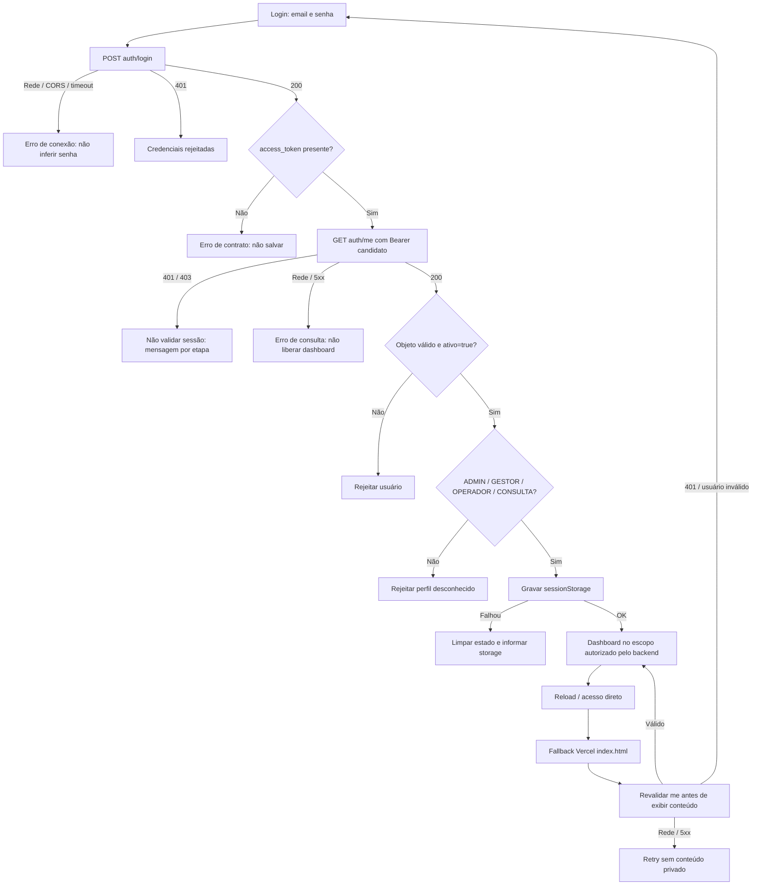

# Integração frontend–backend: autenticação e sessão

Revisão: 24/11/2026. [Diagnóstico](diagnostico-login-vercel.md) · [Vercel](configuracao-vercel.md) · [Checklist](checklist-validacao-producao.md).

## URL e transporte

- API base: `https://chico-sense-back.onrender.com` (somente origem, sem /api/v1).
- Frontend: `https://chico-sense-frontend.vercel.app`; desenvolvimento: http://localhost:5173 ou http://127.0.0.1:5173.
- VITE_API_URL tem fallback para a API acima e é incorporada ao build; mudar variável remota exige novo build. [Referência Vite](https://vite.dev/guide/env-and-mode).
- Cada service inclui `/api/v1` uma única vez. Não apontar a base para `/docs`, `/auth`, para o frontend ou para localhost em Production.
- Requisições via Axios, timeout 60000 ms, Accept application/json. Não há cookie de autenticação nem withCredentials habilitado pelo cliente. O login usa JSON; GETs privados levam Authorization Bearer. Não colocar token em URL ou log.

## POST /api/v1/auth/login

Público; corpo obrigatório JSON. Email é aparado no frontend; senha não é aparada. Nenhum papel, empresa_id ou hash deve ser enviado.

```http
POST /api/v1/auth/login
Content-Type: application/json
Accept: application/json
```

```json
{"email":"usuario@example.com","senha":"SENHA_FICTICIA_SUBSTITUIR_NO_TESTE_AUTORIZADO"}
```

Resposta estrutural ilustrativa (não é token válido nem credencial para produção):

```json
{"access_token":"<JWT_RETORNADO_PELA_API>","token_type":"bearer","expires_in":1800}
```

expires_in é expiração em segundos, configurável pelo backend (padrão local 30 min). O frontend exige token string não vazio e não libera conteúdo apenas por receber 200. Nenhum Bearer armazenado é anexado ao login.

| HTTP | Comportamento |
|---|---|
| 200 | Capturar token temporariamente e consultar /me |
| 401 | Credenciais inválidas/usuário inativo: mostrar rejeição de login, não continuar |
| 422 | Entrada inválida; verificar email/senha/limites |
| 503 | Configuração de autenticação indisponível; não tratar como senha errada |
| Sem resposta legível | Rede, timeout ou CORS: não inferir rejeição de credenciais |

## GET /api/v1/auth/me

```http
GET /api/v1/auth/me
Accept: application/json
Authorization: Bearer <JWT_RETORNADO_PELA_API>
```

O token candidato é enviado explicitamente antes de persistir a sessão. Resposta ilustrativa conforme CurrentUserResponse, com dados hipotéticos:

```json
{
  "id":"00000000-0000-0000-0000-000000000001",
  "created_at":"2026-11-24T10:00:00Z",
  "updated_at":"2026-11-24T10:00:00Z",
  "nome":"Usuário de teste",
  "email":"usuario@example.com",
  "ativo":true,
  "perfil_id":"00000000-0000-0000-0000-000000000002",
  "perfil":"OPERADOR",
  "empresas":[]
}
```

ativo é booleano no contrato publicado. Ausente, false, "true" ou 1 não é usuário ativo validado pelo frontend. perfil é string ou null no schema geral; a aplicação só aceita os quatro papéis oficiais conhecidos. Um papel desconhecido exige revisão do contrato, não alias silencioso. `empresas` é a lista de vínculos ativos descrita pelo backend; lista vazia não concede acesso global. ADMIN tem abrangência definida pelo servidor, não por essa lista no browser.

O nome apresentado usa `nome`→`name` apenas para compatibilidade visual. Esse mapeamento não altera autorização.

## Papéis e isolamento

| API / frontend | Rótulo | Regras backend relevantes |
|---|---|---|
| ADMIN | Administrador | Administração global; catálogo global e ThingSpeak global; endpoints ainda validam estado/integridade |
| GESTOR | Gestor | Escopo empresarial ativo; gestão de frota e configurações ambientais; ações privilegiadas de simulação |
| OPERADOR | Operador | Operações logísticas/monitoramento no escopo; sem gestão de frota/configuração ambiental privilegiada |
| CONSULTA | Consulta | Leitura no escopo; não escreve |

Esses nomes permanecem **exatamente iguais**, inclusive maiúsculas. PRODUTOR, TRANSPORTADORA e CLIENTE são tipos de empresa; produtor/logistica/cliente eram personas do frontend antigo e não são sinônimos dos papéis. Não há modo de escolher um perfil/empresa para obter permissão. O backend confere vínculos e ancestralidade de recursos a cada requisição. Ler um ID não autoriza enviá-lo como credencial. A UI não substitui essa validação.

As permissões por endpoint devem ser consultadas no backend: [contrato consolidado](https://github.com/RenataGusmao/chico_sense_back/blob/816bc4b728c711065cf01567c3bac491210e2277/docs/chicosense/contratos-api.md). Esta correção não redesenha todos os controles de escrita das telas nem cria novas permissões.

## JWT, storage e restauração

O código backend lido assina HS256 e exige sub UUID, iat, exp, iss/aud chicosense-api e type=access; consulta usuário ativo. Não foi inspecionada assinatura/chave/token de produção. O frontend trata o JWT como **opaco** e valida identidade/papel por /me, sem extrair permissões de claims não verificados.

Somente após POST, /me, ativo=true e perfil reconhecido, a UI salva `chicosense_token` em **sessionStorage**, chama o App e navega para /dashboard. Não salva senha nem objeto de usuário como prova de identidade. Falha limpa token candidato e o campo de senha. Storage negado impede conclusão com mensagem explícita.

sessionStorage é separado por origem/aba e dura a sessão da aba; não é cookie httpOnly e continua sujeito a risco de XSS. Nenhuma alteração de política de armazenamento foi feita neste patch. Não há refresh/logout remoto; Sair remove token e estado local. Não há garantia de revogação de JWT já emitido pelo simples logout local.

No reload com token: o App mostra “Verificando sessão…”, consulta /me e só então exibe rotas. 401/usuário inválido/perfil desconhecido limpa sessão. Falha de rede/5xx/429 mantém o token sem mostrar conteúdo privado e permite retry ou voltar ao login. A restauração não faz novo POST de senha.

## Interceptors e concorrência

1. Login e /health não enviam Bearer, inclusive se restar um header indevido na configuração.
2. Outras requisições recebem token armazenado apenas se não houver Authorization explícito; /me usa token candidato explicitamente.
3. O interceptor só emite auth:expired em 401 privado quando o Authorization enviado corresponde **ao token atualmente armazenado**.
4. O primeiro 401 limpa o token; outro 401 simultâneo da mesma sessão não dispara nova expiração. Um 401 tardio de token antigo não apaga login novo.
5. Falha de rede e 403 não significam sessão expirada. GET /health é somente conectividade de processo, não valida senha, JWT, banco ou vínculo.
6. Os logs do interceptor limitam-se a método/path/status/code, sem senha/Bearer. Outras páginas ainda podem registrar objetos de erro brutos; não copiar o console inteiro ou HAR sem revisão de dados sensíveis.

## Erros por etapa

| Falha | Tratamento |
|---|---|
| POST 401 | Email/senha incorretos; não chega ao /me |
| POST 200 sem token | Resposta incompatível, sem armazenamento |
| /me 401 | “Login retornou um token, mas API recusou consulta do usuário”; não afirmar senha incorreta |
| /me 403 | Acesso sem permissão |
| /me 200 malformado | Rejeitar resposta |
| ativo não true | Rejeitar usuário |
| perfil desconhecido/null | Rejeitar perfil; não promover/alias |
| Erro ao salvar sessionStorage | Não entrar; informar limitação do navegador |
| Timeout | Mensagem de demora; não classificar como senha |
| Sem resposta legível | Mensagem de conexão; usar checklist para separar rede/CORS |
| HTTP 409/422/503 | Respeitar mensagem/validação e estado; não limpar sessão como se fosse 401 |

Erros FastAPI podem ter detail string ou lista de {type,loc,msg}. O cliente normaliza ambos. Senha/token nunca devem fazer parte de mensagem apresentada ou evidência compartilhada.

## Fluxo com erros



## Evidências de validação

[tests/auth.test.js](../tests/auth.test.js): 23 casos de contrato/papéis/ativo/token/mensagens e concorrência. [tests/App.test.jsx](../tests/App.test.jsx): 14 casos com UI/rotas reais e HTTP mockado, incluindo dashboard/viagens/configurações para quatro papéis, reload e expiração. Não validam assinatura real de JWT nem permissões do banco; isso pertence aos testes do backend e à homologação autorizada.
